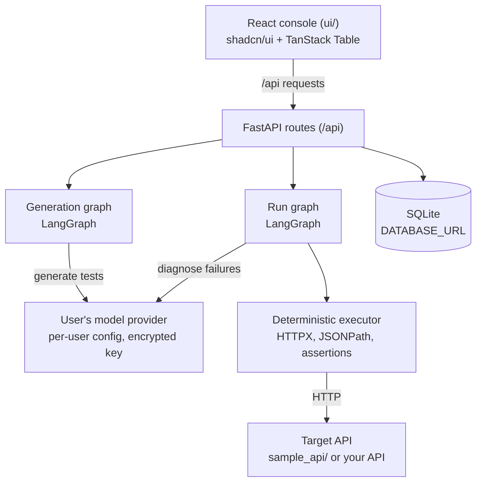

# TestOrbit — AI-powered Backend API Testing Platform

**Version:** 2.0
**Status:** Implementation specification (MVP)
**Scope:** Backend REST API testing only
**Stack:** React + Vite + TypeScript (`ui/`), FastAPI + SQLAlchemy + LangGraph/LangChain (`server/`), HTTPX execution, SQLite persistence
**Companion document:** [`docs/api-contract.md`](docs/api-contract.md) is the source of truth for types and routes.

One architectural principle governs the whole product: **LLMs generate and diagnose tests; deterministic code executes requests and evaluates assertions.** The platform never uses LLM judgment where an exact, objective check is possible.

---

# 1. Overview

## 1.1 Product Vision

TestOrbit discovers, generates, executes, and diagnoses tests for REST APIs described by OpenAPI. It understands endpoint contracts, proposes multi-step workflows across endpoints, and explains failures in plain language.

Users sign up to TestOrbit and bring their own LLM. TestOrbit ships no model and no shared API keys.

The platform supports:

- Platform accounts: sign-up, log-in, and per-user projects, models, and runs
- Bring-your-own model: OpenAI, Anthropic, Google Gemini, Azure OpenAI, Ollama, and any OpenAI-compatible endpoint
- Automatic detection of target-API authentication from the OpenAPI spec
- Functional testing (happy path, negative, boundary) and authentication testing
- Cross-endpoint workflow testing (create, read, update, delete, verify)
- AI-assisted failure diagnosis with suggested fixes
- Test review and approval before execution
- Run history
- Regression comparison between runs (P1)

## 1.2 Problem Statement

1. Test cases require significant manual authoring.
2. Endpoints are often tested in isolation, missing the relationships between them.
3. Test suites drift as API contracts evolve.
4. Diagnosing a failed test requires manual investigation.

TestOrbit addresses these through contract-driven generation, deterministic execution, and automated diagnosis in one workflow.

## 1.3 Primary Users

- Backend developers validating REST APIs
- QA engineers creating and maintaining API test suites
- Engineering teams running regression checks against local or staging APIs

## 1.4 MVP Success Criteria

A user can:

1. Sign up and log in.
2. Add a model under Models and test the connection.
3. Create a project from an OpenAPI spec URL or uploaded JSON file.
4. Check the target-API authentication that TestOrbit detected from the spec.
5. Select endpoints and test categories, then generate test cases.
6. Review, edit, and approve generated cases.
7. Run approved cases, including a multi-step CRUD workflow.
8. Identify the intentionally introduced defect in `sample_api/`.
9. Read an AI diagnosis for each failed test.
10. Inspect run results after a restart, since all data persists in SQLite.

---

# 2. Scope and Priorities

## 2.1 P0 — MVP

| Module | Required capability |
| --- | --- |
| Platform accounts | Sign-up and log-in with JWT sessions; every project, model, test, and run belongs to its owner |
| Model configuration | Per-user models from any supported provider; per-project model with a default; keys encrypted at rest; test connection |
| Persistence | SQLite through SQLAlchemy (`DATABASE_URL`) |
| Project setup | Name, target base URL, OpenAPI spec URL or uploaded JSON |
| API discovery | Parse endpoints, methods, parameters, schemas, and security metadata |
| Authentication | Target-API signup and signin flow auto-detected from the spec; read-only view with Verify |
| Test generation | Happy path, negative, boundary, auth, and workflow cases |
| Test management | Review, edit, approve, and delete generated cases |
| Execution | HTTP requests, deterministic assertions, variable extraction and substitution |
| Workflow testing | Ordered create → read → update → verify → delete → verify steps |
| Failure diagnosis | Classify failures and recommend fixes |
| UI | Login, Dashboard, Projects, API Explorer, Test Cases, Runs, Run Detail, Authentication, Models |

## 2.2 P1 — Post-MVP

- Regression comparison between runs, including run history per project
- Persisted baselines and explicit baseline approval
- OAuth2 and refresh-token workflows
- Response validation against OpenAPI response schemas
- Multiple environments per project
- Import/export of test suites
- Test suite versioning and approval history
- Parallel execution of independent tests
- Evaluation experiments on generated-test quality
- CI/CD integration

## 2.3 P2 — Future

- Scheduled regression testing
- Performance and load testing
- Distributed test execution
- Advanced security testing
- PR-triggered testing
- Automatic test maintenance after contract changes
- Visual workflow editor
- Teams, organizations, roles, and audit logs

---

# 3. Functional Requirements

## FR-01: Accounts and Access

- Sign-up takes `email`, `password` (minimum 8 characters), and an optional `name`. Log-in takes `email` and `password`. Both return a bearer token valid for `ACCESS_TOKEN_DAYS` (default 7).
- Passwords are stored only as Argon2 hashes.
- All routes require `Authorization: Bearer <token>` except health, sign-up, log-in, and the provider list. A `401` makes the UI log out.
- Every resource belongs to one user. Another user's ID returns `404`.

**Acceptance criteria**

- A new user can sign up, log in, and see an empty dashboard.
- A second user cannot read, modify, or run the first user's projects.

## FR-02: Bring-Your-Own Model

Supported providers (`Provider` in the contract):

| Provider | ID |
| --- | --- |
| OpenAI | `openai` |
| Anthropic | `anthropic` |
| Google Gemini | `google` |
| Azure OpenAI | `azure_openai` |
| Ollama (local) | `ollama` |
| OpenAI-compatible | `openai_compatible` (presets: Groq, OpenRouter, Together, DeepSeek, Mistral, xAI, Fireworks, LM Studio, vLLM) |

The fields each provider needs (API key, base URL, API version, deployment) come from `GET /api/models/providers`.

**Rules**

- A user adds any number of model configurations under *Models*. Each has a label, provider, provider model ID, and provider-specific fields.
- The first model added becomes the default. Marking another model as default clears the previous one.
- A project may set `model_config_id`. If it is unset, the project uses the user's default model. Deleting a model moves its projects to the default.
- API keys are encrypted at rest with Fernet, using a key derived from `SECRET_KEY`. The API never returns a key. It returns `api_key_hint` (for example `sk-…a1b2`).
- *Test connection* works before saving (`POST /api/models/test`) and on a saved model (`POST /api/models/{id}/test`). It reports success, latency, the reply, or the error.
- Without any model, test generation returns `400 "No model configured. Add one under Models."`. Runs still execute, but without AI diagnosis.
- The model serves test generation, the auth-detection fallback, and failure diagnosis.

**Acceptance criteria**

- Test connection reports success with latency for a valid key and a readable error for an invalid one.
- A saved key is never visible in any response, log, or page.

## FR-03: Project and API Configuration

A project contains: name, target `base_url`, OpenAPI source (`spec_url` or uploaded `spec` object), optional `model_config_id`, detected authentication plan, and creation metadata.

- The spec is fetched and parsed when the project is created.
- An invalid or unsupported spec is rejected with an actionable `400 {detail}` error.
- Only the configured `base_url` is a valid execution target.

**Acceptance criteria**

- A valid OpenAPI 3.x document can be imported by URL or upload.
- Endpoints appear in the API Explorer after import.
- Invalid specs produce feedback that names the failing reason.

## FR-04: API Discovery and Dependency Analysis

Discovery extracts, per endpoint (`Endpoint` type in the contract):

- Method, path, summary, and tags
- Raw parameters and request body schema
- Response schemas by status code
- Whether the operation requires authentication

The system proposes dependencies between operations using path parameters and resource identifiers. Example: `POST /items` returns an `id`, which `GET`, `PUT`, and `DELETE /items/{item_id}` consume.

**Constraint:** Dependencies inferred by the LLM are marked *proposed* until schema evidence, user approval, or a successful execution confirms them.

## FR-05: AI Test Case Generation

Generation combines deterministic rules with LLM reasoning, using the project's model.

| Category | Covers |
| --- | --- |
| `happy_path` | Valid requests produce documented success responses and response fields |
| `negative` | Missing required fields, wrong types, malformed bodies, invalid or missing auth |
| `boundary` | Documented minimum and maximum values, lengths, ranges, and enum values |
| `auth` | Authenticated requests, missing and invalid tokens |
| `workflow` | Ordered multi-step scenarios where later steps use data from earlier steps |

Each generated test has the `TestCase` fields in the contract: name, description, category, endpoint reference, method, path (with `{{var}}` placeholders), headers, query, body, expected status codes, assertions, extraction rules, auth requirement, order, and approval state.

**Rules**

- Expected behavior comes from the OpenAPI contract or an explicit user instruction.
- If expected behavior cannot be established, the test has an assertion-free status check and a description that flags it for review. The system must not invent assertions.
- Generated tests start with `approved: false`.
- Regeneration reuses existing tests unless the endpoint set, categories, or spec change. Tests affected by a spec change are flagged.

## FR-06: Target-API Authentication (Auto-Detected)

Authentication controls how TestOrbit calls the **target API**. Users do not configure it.

- At project creation, and on *Re-detect*, the server reads the OpenAPI spec and finds the signup and signin endpoints, their payloads, the token location, and the header to send.
- Heuristics run first. If they cannot decide, the project's model proposes the plan. The result records its source (`heuristic` or `llm`).
- Request bodies use `{{username}}`, `{{email}}`, and `{{password}}` placeholders. Each run replaces them with fresh, disposable values.
- The token is read with a JSONPath (for example `$.access_token`) and sent in the detected header. The scheme is `bearer` or `api_key`.
- If the spec has no protected endpoints, the plan type is `none`. If protected endpoints exist but no signin flow is found, the plan is marked not detected and the Authentication view says so.
- *Verify now* performs signup and signin live against the target and shows each step: request, response with tokens redacted, status, and error.
- Every run signs up and signs in before protected tests. A failed sign-in marks dependent tests `error` with an `auth_failure` diagnosis.
- Tokens are never stored, returned, logged, or sent to the LLM. `Authorization` is redacted in results.

**Acceptance criteria**

- Against `sample_api/`, detection finds signin and token location with no user input.
- A protected test passes after a run without any stored credential.

## FR-07: Cross-Endpoint Workflow Testing

A workflow is an ordered sequence of `workflow` tests in one project that share runtime variables.

Example: item lifecycle

1. Create an item; extract `item_id` from `$.id`.
2. Read the item; verify it matches the created data.
3. Update the item; read again and verify the change.
4. Delete the item.
5. Read the deleted item; verify the contract-defined response (typically 404).
6. Verify the item is absent from the collection, where applicable.

**Engine requirements**

- Ordered, sequential execution (`order` field)
- JSONPath extraction into runtime variables
- `{{var}}` substitution in path, headers, query, and body
- Per-step assertions
- Stop-on-failure for dependent steps
- Best-effort cleanup of resources created during the run
- Bounded retries

The engine distinguishes an **operation failure** (for example, DELETE returns 500) from a **failed assertion** (for example, DELETE returns 204 but the follow-up GET still returns the item).

## FR-08: Test Execution Engine

Execution is deterministic Python using HTTPX. The LLM is not in the execution path.

Responsibilities:

- Build requests from approved test definitions
- Resolve runtime variables and inject authentication
- Execute requests with timeouts (`REQUEST_TIMEOUT`) and a per-run request limit
- Capture status code, headers, body, resolved URL, and latency
- Evaluate deterministic assertions
- Record errors and timeouts as `error` results
- Persist results to the run record

**Assertion types** (the `Assertion` type in the contract)

| Type | Check |
| --- | --- |
| Status code | Status is in `expected_status` |
| `field_exists` | JSONPath resolves to a value |
| `field_equals` | JSONPath value equals a given value |
| `field_type` | JSONPath value is `string`, `number`, `integer`, `boolean`, `object`, `array`, or `null` |
| `body_contains` | Response body contains a substring |
| `max_latency_ms` | Latency is at or below a threshold |

Each assertion produces an `AssertionResult` with `passed` and a readable `message`.

## FR-09: Failure Diagnosis and Controlled Repair

When a test ends `failed` or `error`, the diagnosis step asks the project's model to classify it. The evidence is the request, the response, the failed assertions, and the spec excerpt for the endpoint. Without a model, diagnosis is skipped and the result says so.

| Category | Meaning |
| --- | --- |
| `api_defect` | The API violates its documented contract or expected behavior |
| `contract_mismatch` | The spec and implementation disagree in a way that is not clearly a defect |
| `invalid_test` | The generated test is wrong (bad expectation, bad path, bad data) |
| `auth_failure` | Sign-in failed, token missing, or access denied |
| `environment` | Network, DNS, timeout, or unreachable target |
| `unknown` | Evidence is insufficient to classify |

Each diagnosis contains `category`, `explanation` (observed vs. expected, with evidence), and `suggested_fix`.

**Repair policy**

- If a test is demonstrably invalid, the platform may propose a corrected version.
- The original test and its result are preserved.
- A correction must never change an expected outcome solely to make the API pass.
- At most one bounded rerun of an approved correction.

## FR-10: Regression Comparison (P1)

Users rerun a saved suite of approved tests and compare two runs:

- Previously passing tests that now fail, and the reverse
- Tests added or removed since the baseline
- Latency changes per test

Comparisons use stable test IDs. A baseline must be selected explicitly; saving a run never makes it the expected standard.

## FR-11: Reporting

Every run produces a `Run` record containing:

- Run ID, project ID, status (`running`, `completed`, `failed`), start and finish times
- Summary counts: total, passed, failed, error, skipped, and duration
- Authentication check performed at the start of the run
- Per-test `TestResult` records with request, response, assertion results, error, and diagnosis

Reports distinguish deterministic API results (`passed`, `failed`, `error`) from AI diagnoses, which are labeled as AI output in the UI.

---

# 4. Technical Architecture

## 4.1 Layers

| Layer | Responsibility | Technology |
| --- | --- | --- |
| Frontend (`ui/`) | Console UI | React, TypeScript, Vite, Tailwind CSS v4, shadcn/ui, TanStack Table, TanStack Query, React Router, lucide-react, sonner |
| Backend API (`server/`) | REST routes under `/api` | FastAPI, Pydantic |
| Accounts | Login tokens and password storage | PyJWT, pwdlib (Argon2) |
| Persistence | Users, models, projects, tests, runs | SQLite through SQLAlchemy 2.x (`DATABASE_URL`) |
| Secrets | Encryption of stored model keys | `cryptography` (Fernet), key derived from `SECRET_KEY` |
| Orchestration | Generation and run workflows | LangGraph |
| Model integration | Provider adapters for the user's model | LangChain provider packages (OpenAI, Anthropic, Google, Ollama, OpenAI-compatible) |
| Execution | HTTP, JSONPath, assertions | HTTPX, `jsonpath-ng`, deterministic Python |
| Target | System under test | `sample_api/` (FastAPI demo) or any OpenAPI 3.x API |

Vite's dev server proxies `/api` to the FastAPI backend on `http://localhost:8000`. In Docker, nginx serves the built UI and proxies `/api/` to the `server` service.

## 4.2 Logical Architecture



The target API and the model provider are separate systems with separate credentials.

## 4.3 Repository Structure

```
testorbit/
├── ui/                       React + Vite + TypeScript console
├── server/                   FastAPI backend, SQLAlchemy, LangGraph workflows
│   ├── app/
│   ├── .env.example
│   ├── Dockerfile
│   └── requirements.txt
├── sample_api/               FastAPI demo target with one deliberate defect
├── docs/
│   └── api-contract.md       types and routes (source of truth)
├── docker-compose.yml
├── README.md
└── prd.md
```

## 4.4 Model Access

- Each user's model configuration is stored in the database. Keys are encrypted (see FR-02).
- Graph nodes ask for a model through a factory keyed by the project's configuration. They never depend on a provider or model name.
- Structured output uses the provider's structured-output support. If it is unavailable, the server falls back to prompt-based JSON validated by Pydantic.
- Generation runs at low temperature for repeatable output.
- The top bar shows the default model's label, or a warning that links to *Models* when none is configured.

## 4.5 Key Design Decisions

| Decision | Choice |
| --- | --- |
| Product | TestOrbit |
| Scope | Backend REST API testing |
| Accounts | Email and password, JWT bearer tokens |
| Models | Bring-your-own, per user; no model shipped with the product |
| Frontend | React + Vite + TypeScript |
| UI library | shadcn/ui (Radix + Tailwind v4) |
| Data tables | TanStack Table |
| Backend | FastAPI |
| Orchestration | LangGraph |
| Persistence | SQLite via SQLAlchemy (`DATABASE_URL`) |
| Target authentication | Auto-detected from the spec |
| Execution | HTTPX with deterministic assertions |
| Demo target | `sample_api/` |

---

# 5. LangGraph Workflow Design

Two graphs keep generation and execution separate, so the user can review tests before anything runs.

**Generation graph** (`POST /api/projects/{id}/tests/generate`)

1. `load_specification`: load the project's parsed endpoints and spec excerpts.
2. `analyze_endpoints`: select the endpoints and categories requested.
3. `discover_dependencies`: propose endpoint dependencies (LLM, marked *proposed*).
4. `generate_test_cases`: produce structured `TestCase` objects (LLM, structured output).
5. `validate_generated_tests`: deterministic checks: schema shape, known assertion types, methods and paths exist in the spec, placeholders resolve to extracted variables.
6. `persist_tests`: save tests with `approved: false`.

**Run graph** (`POST /api/projects/{id}/runs`)

1. `prepare_authentication`: sign up and sign in using the detected plan, with fresh disposable credentials (deterministic).
2. `execute_test_suite`: run approved tests in `order` (deterministic HTTP).
3. `evaluate_assertions`: evaluate the assertion types in FR-08 (deterministic).
4. `diagnose_failures`: classify each `failed` or `error` test with structured evidence (LLM, skipped without a model).
5. `propose_test_repairs`: for `invalid_test` results, propose a corrected test (LLM, optional, one bounded rerun).
6. `aggregate_report`: compute the run summary (deterministic).
7. `persist_run`: save the run record.

**Graph state** keeps no secrets. Tokens and disposable credentials live in a per-run execution context that is discarded when the run ends.

## 5.1 Execution Rules

- Generation precedes execution; tests must pass validation before approval.
- Only `approved: true` tests run by default.
- Destructive tests (`DELETE`, and any `POST` or `PUT` that mutates data) require explicit approval before a run.
- Authentication completes before protected tests run.
- Workflow steps run sequentially; a failed dependency skips later steps in the same workflow.
- Retries are bounded.
- Every run ends with a terminal status (`completed` or `failed`), including runs that stop early. Partial results are kept.

## 5.2 Human-in-the-Loop

Generation saves tests as `approved: false`. The user edits and approves them through `PATCH /api/tests/{id}` and `POST /api/projects/{id}/tests/approve`. Only then can a run start. Runs are synchronous in the MVP.

---

# 6. Data Model

## 6.1 Test Case

The full `TestCase` type is in [docs/api-contract.md](docs/api-contract.md). Example:

```json
{
  "id": "t_ab12cd",
  "project_id": "p_ab12cd",
  "name": "Create item successfully",
  "description": "A valid item is created and returns an id",
  "category": "happy_path",
  "endpoint_id": "POST /items",
  "method": "POST",
  "path": "/items",
  "headers": {},
  "query": {},
  "body": { "name": "Test Item", "price": 9.5 },
  "expected_status": [201],
  "assertions": [{ "type": "field_exists", "path": "$.id" }],
  "extract": { "item_id": "$.id" },
  "requires_auth": true,
  "order": 1,
  "approved": false,
  "created_at": "2026-10-31T10:00:00Z"
}
```

## 6.2 Workflow

A workflow is not a separate entity. It is the set of `workflow` tests in one project, ordered by `order`, where later tests reference variables from `extract` in earlier tests (`{{item_id}}`).

## 6.3 Persistence (SQLite)

- The database is set by `DATABASE_URL` (default `sqlite:///./testorbit.db`) and accessed through SQLAlchemy 2.x. The schema is created on startup.
- Tables: `users`, `model_configs`, `projects`, `tests`, `runs`.
- Every user-owned row carries `user_id`. Projects reference an optional model configuration. Tests and runs reference their project.
- Runs store the test definitions and results they executed, so run history stays readable after tests change.
- Repository methods wrap all reads and writes, so services do not depend on the database engine. This replaces the earlier JSON file store (`server/data.json`).

## 6.4 Data Integrity and Secrets

- Runs reference the test definitions as they were at execution time.
- Results reference stable test IDs.
- Model API keys are encrypted at rest. Changing `SECRET_KEY` makes them unreadable.
- Passwords are stored as Argon2 hashes. Login tokens are signed with `SECRET_KEY`.
- Target-API tokens and disposable credentials are never stored in plaintext in any table.
- Large response bodies are truncated at a configured limit.
- Failed and partial runs remain inspectable.

---

# 7. Backend API Contracts

The full contract, including types and the error format, is in [docs/api-contract.md](docs/api-contract.md). Routes:

| Method | Path | Body | Returns |
| --- | --- | --- | --- |
| POST | `/api/auth/signup` | `{email, password, name?}` | `Session` |
| POST | `/api/auth/login` | `{email, password}` | `Session` |
| GET | `/api/auth/me` | – | `User` |
| GET | `/api/health` | – | `{ok: true}` |
| GET | `/api/models/providers` | – | `ProviderInfo[]` |
| GET | `/api/models` | – | `ModelConfig[]` |
| POST | `/api/models` | `ModelConfigIn` | `ModelConfig` |
| PATCH | `/api/models/{id}` | partial `ModelConfigIn` | `ModelConfig` |
| DELETE | `/api/models/{id}` | – | `{ok: true}` |
| POST | `/api/models/test` | `ModelConfigIn` | `ModelTestResult` |
| POST | `/api/models/{id}/test` | – | `ModelTestResult` |
| GET | `/api/projects` | – | `Project[]` |
| POST | `/api/projects` | `{name, base_url, spec_url?, spec?, model_config_id?}` | `Project` |
| GET | `/api/projects/{id}` | – | `Project` |
| PATCH | `/api/projects/{id}` | `{name?, base_url?, model_config_id?}` | `Project` |
| DELETE | `/api/projects/{id}` | – | `{ok: true}` |
| GET | `/api/projects/{id}/endpoints` | – | `Endpoint[]` |
| POST | `/api/projects/{id}/auth/detect` | – | `Project` |
| POST | `/api/projects/{id}/auth/verify` | – | `AuthCheck` |
| POST | `/api/projects/{id}/tests/generate` | `{endpoint_ids, categories, max_tests?}` | `TestCase[]` |
| GET | `/api/projects/{id}/tests` | – | `TestCase[]` |
| PATCH | `/api/tests/{id}` | partial `TestCase` | `TestCase` |
| DELETE | `/api/tests/{id}` | – | `{ok: true}` |
| POST | `/api/projects/{id}/tests/approve` | `{test_ids, approved}` | `TestCase[]` |
| POST | `/api/projects/{id}/runs` | `{test_ids?}` | `Run` |
| GET | `/api/projects/{id}/runs` | – | `Run[]` |
| GET | `/api/runs/{id}` | – | `Run` |

Errors are non-2xx responses with `{detail: string}`. Regression routes (P1) are not in the MVP contract and will be added when implemented.

---

# 8. Frontend Requirements

## 8.1 UI Principles

- A developer tool: clear navigation, dense but readable tables, minimal decoration.
- Light mode only.
- Strong distinction between `passed`, `failed`, `error`, and `skipped` states.
- Details open in a `Sheet` or on the same page, not in deep modal chains.
- Monospace text for paths, JSON, IDs, and headers.
- Keyboard-accessible controls (shadcn/ui is Radix-based).

## 8.2 Visual Theme

- Primary: light green accent (`green-600` for buttons and active navigation, `green-50` for highlighted surfaces).
- Surfaces: white backgrounds, `zinc-200` borders, `zinc-900` body text, `zinc-500` secondary text.
- Status colors: green for passed, red for failed, amber for error or warning, zinc for skipped.
- Color tokens are defined once as CSS variables (Tailwind v4 `@theme`). No inline hex values in components.
- No gradients, glassmorphism, or decorative illustrations.

## 8.3 Component Rule

Every UI element comes from shadcn/ui or a library listed in §4.1. No hand-rolled imitations of tabs, dropdowns, or tables. Application components are compositions of shadcn/ui primitives.

Allowed components: Sidebar, Breadcrumb, Card, Table (with TanStack Table), Badge, Button, Input, Textarea, Select, Checkbox, RadioGroup, Switch, Tabs, Sheet, Dialog, AlertDialog, Alert, Progress, Skeleton, ScrollArea, Separator, Tooltip, DropdownMenu, Sonner, Label.

JSON, requests, responses, and headers are shown in a `<pre>` element with monospace type inside a `ScrollArea`.

## 8.4 Application Shell

**Sidebar**

- Dashboard
- Projects
- API Explorer (current project)
- Test Cases (current project)
- Runs (current project)
- Authentication (current project)
- Models (account level)

**Top bar**

- `Breadcrumb` showing project and page
- Current project name
- Default model badge (or a warning when none is set)
- `DropdownMenu` with project actions and account actions (log out)

**Main content:** page-specific content.

---

# 9. Screens

| # | Screen | Purpose |
| --- | --- | --- |
| 01 | Login | Sign up and log in |
| 02 | Dashboard | Project testing activity |
| 03 | Projects | Create and manage projects |
| 04 | API Explorer | Inspect endpoints and generate tests |
| 05 | Test Cases | Review, edit, and approve tests |
| 06 | Runs | Start runs and review history |
| 07 | Run Detail | Results and failure analysis for one run |
| 08 | Authentication | Read-only view of detected target-API auth, with Verify |
| 09 | Models | Add, test, and manage the user's models |
| 10 | Regression (P1) | Compare two runs |

## Screen 01 — Login

**Content:** `Tabs` for "Log in" and "Sign up". Fields: email, password, and name (sign-up only). Server errors appear in `Alert`. Success navigates to the Dashboard.

**Components:** Card, Tabs, Input, Label, Button, Alert, Sonner.

## Screen 02 — Dashboard

**Purpose:** overview of the current project's testing activity.

**Content**

- Summary cards: approved test count, runs in the last 7 days, pass rate, failed-test count, average run duration
- Pass rate as `Progress`
- Recent runs `Table`
- Failed tests in the latest run, with category `Badge`
- Quick actions: Generate tests, Run approved tests

**Empty states**

- No projects: a `Card` explaining TestOrbit with a primary "Create project" button.
- No model: an `Alert` stating that a model is needed before generation, with a link to *Models*.

**Components:** Sidebar, Breadcrumb, Card, Table, Badge, Button, Progress, Skeleton, Alert, Tooltip.

## Screen 03 — Projects

**List:** `Table` with name, base URL (monospace), endpoint count, authentication status, model, created date, and row actions.

**Create project** (`Dialog`)

- Name and description (`Input`, `Textarea`, `Label`)
- Target base URL (`Input`)
- Spec source (`Tabs`): "Spec URL" (`Input`) or "Upload JSON" (`Input type="file"`)
- Model (`Select`): project default (the user's default model) or a specific model
- Server errors from `400 {detail}` shown in `Alert`

**Project detail:** `Card` with base URL, spec source, endpoint count, model selection, and links to API Explorer, Test Cases, Runs, and Authentication. Delete uses `AlertDialog`.

**Components:** Card, Table, Dialog, Tabs, Select, Input, Textarea, Label, Button, Alert, AlertDialog, Badge, Sonner.

## Screen 04 — API Explorer

**Purpose:** inspect discovered endpoints and start test generation.

**Layout**

- Left: search `Input` and endpoint list in `ScrollArea`, grouped by tag. Each row shows a method `Badge`, path, and auth indicator.
- Right: selected endpoint with `Tabs`: Overview (summary, auth requirement, proposed dependencies marked *proposed*), Parameters, Request schema, Responses. Schemas render in `<pre>`.

**Generate tests** (`Dialog`)

- Category `Checkbox` group (`happy_path`, `negative`, `boundary`, `auth`, `workflow`)
- Max tests (`Input`)
- Generate `Button` in loading state; a note says generation can take 10–60 seconds
- Result toast with count; the user lands on Test Cases filtered to the new tests

**Components:** Sidebar, Breadcrumb, Input, ScrollArea, Badge, Tabs, Card, Separator, Dialog, Checkbox, Label, Button, Skeleton, Tooltip, Sonner.

## Screen 05 — Test Cases

**Purpose:** review, edit, approve, and delete generated tests before running them.

**Table** (TanStack Table in `Table`)

Columns: selection `Checkbox`, order, name, category `Badge`, endpoint (monospace), approval `Badge`, row actions `DropdownMenu`.

**Filters:** category `Select` and search `Input`.

**Bulk actions:** Approve selected, Unapprove selected, Run selected, Delete selected (`AlertDialog`).

**Edit** (`Sheet`)

- `Tabs`: Request (method, path, headers, query, body as JSON in `Textarea`), Assertions (JSON), Expected (status codes), Extraction (JSON)
- Client-side JSON validation with inline errors in `Alert`
- Save calls `PATCH /api/tests/{id}`; success toast via `Sonner`
- Approve toggle and "Duplicate" in the sheet header

**Components:** Sidebar, Breadcrumb, Table, Select, Input, Checkbox, Badge, Button, Sheet, Tabs, Textarea, Label, Alert, AlertDialog, DropdownMenu, Tooltip, Sonner.

## Screen 06 — Runs

**Runs list** (`Table`): status `Badge`, started, duration, passed, failed, error, skipped. Newest first.

**Start run:** "Run approved tests"; with a selection, "Run selected". Runs are synchronous. The button shows a loading state, a `Skeleton` marks the in-progress row, and `Sonner` reports completion.

**Components:** Sidebar, Breadcrumb, Table, Badge, Button, Skeleton, Sonner, Tooltip.

## Screen 07 — Run Detail

**Header:** run status `Badge`, start and finish times, duration, and summary `Card`s (total, passed, failed, error, skipped).

**Partial or failed runs:** an `Alert` states that the run did not complete and lists completed and remaining tests.

**Results table** (`Table`): test ID, name, category, method, URL, status `Badge`, status code, latency, failure category `Badge`.

**Detail** (`Sheet`, opened from a row)

- `Tabs`:
  - **Request:** method, resolved URL, headers (`Authorization` shown as `[REDACTED]`), body in `<pre>`
  - **Response:** status, headers, body in `<pre>`
  - **Assertions:** each `AssertionResult` with pass or fail `Badge` and message
  - **Diagnosis:** category, explanation, and suggested fix, labeled "AI diagnosis"
- "Re-run this test" button (creates a run with `test_ids: [id]`)

**Components:** Sidebar, Breadcrumb, Card, Table, Badge, Tabs, Sheet, ScrollArea, Alert, Button, Tooltip, Separator, Sonner.

## Screen 08 — Authentication

**Purpose:** show how TestOrbit authenticates to the target API. Read-only. Nothing is entered by hand.

**Content**

- Detected flow: signup endpoint, signin endpoint, token path, and header (scheme and prefix). A `Badge` shows the source (heuristic or LLM).
- The detection `notes` in plain language.
- *Verify now* (calls `POST /auth/verify`): a step list with method, URL, status, request body (credentials are disposable and may be shown), response body with tokens redacted, and the token preview on success.
- *Re-detect* (calls `POST /auth/detect`).

**States**

- No protected endpoints: "No authentication required."
- Protected endpoints but no flow found: `Alert` explaining that detection failed and what the spec is missing.

**Notes card:** each run signs up a fresh disposable user; tokens are never stored or shown after verification.

**Components:** Sidebar, Breadcrumb, Card, Badge, Button, Alert, Separator, Table, Tooltip, Sonner.

## Screen 09 — Models

**Purpose:** manage the user's own models.

**List:** `Table` with name, provider `Badge`, provider model ID (monospace), key hint, default `Badge`, and row actions (Test, Set as default, Edit, Delete). Delete uses `AlertDialog`.

**Add or edit model** (`Dialog`)

- Provider `Select`, loaded from `/api/models/providers`
- Name and provider model ID (`Input`, with the provider's placeholder)
- Provider fields shown as the provider requires: API key (password input; blank on edit keeps the saved key), base URL, API version, deployment
- For OpenAI-compatible providers, a preset `Select` fills the base URL (Groq, OpenRouter, Together, DeepSeek, Mistral, xAI, Fireworks, LM Studio, vLLM)
- *Test connection* (`POST /api/models/test`): result in `Alert` with latency or error
- Save; the first model becomes the default

**Components:** Table, Dialog, Select, Input, Label, Button, Alert, AlertDialog, Badge, DropdownMenu, Sonner.

## Screen 10 — Regression Comparison (P1)

**Controls:** baseline run `Select`, current run `Select`, category `Select`.

**Results:** `Tabs` for Newly failed, Newly passed, Unchanged, Added, Removed, Incomparable, each with a `Table` and counts in `Badge`.

**Components:** Sidebar, Breadcrumb, Select, Tabs, Table, Badge, Card, Alert.

---

# 10. UI State Requirements

Every screen supports these states:

- **Loading:** `Skeleton` placeholders or a loading `Button`.
- **Empty:** a clear explanation and a primary next action.
- **Success:** `Sonner` toast with useful detail (for example, "12 tests generated").
- **Error:** `Alert` with the server's `detail` message and a suggested next step.
- **No model:** an `Alert` pointing to *Models* before any generation or diagnosis action.
- **Partial:** completed results are displayed and remaining failures are explained.
- **Interrupted:** a run that stopped early is labeled `failed` with the last completed test named.
- **Unauthorized:** an `auth_failure` explanation without exposing secrets. A `401` from the platform logs the user out.
- **Inconclusive:** tests with no established expectation are flagged for review, not shown as passed.

Do not display placeholder or mock metrics as real execution results.

---

# 11. Security Requirements

The platform sends HTTP requests and can mutate data, so these controls are mandatory.

## 11.1 Execution Target Restrictions

- Execute only against the project's configured `base_url`.
- Generated tests cannot introduce other hosts. Full URLs in test paths are rejected.
- Do not follow redirects to hosts other than the configured base URL.
- Apply request timeouts and a per-run request limit.
- Require explicit approval before destructive tests run.
- Restrict the MVP to a local or otherwise approved test environment. Do not default to production.

## 11.2 Secret Handling

- Platform passwords are stored as Argon2 hashes.
- Login tokens are signed with `SECRET_KEY`. Set it to a long random value in any shared or production deployment.
- Model API keys are encrypted at rest with Fernet, using a key derived from `SECRET_KEY`. The API never returns them; the UI shows a hint only.
- Changing `SECRET_KEY` signs everyone out and makes saved model keys unreadable. Users must re-enter them.
- Target-API credentials are disposable and generated per run. Tokens are never stored.
- Redact `Authorization` headers in stored and displayed results.
- Never include tokens, credentials, or model keys in LLM prompts or logs.
- Load secrets from environment variables. Never commit `server/.env`.

## 11.3 Test Data Safety

- Use disposable accounts and resources where the target supports them.
- Prefix generated resource names with a run identifier.
- Attempt cleanup after execution and report cleanup failures.
- Never assume DELETE is safe against production data.

## 11.4 LLM Safety

API specifications and HTTP responses are untrusted data. The model must not be able to execute shell commands, change the execution target, or override authorization controls based on content in an API response or spec. Model output is validated against Pydantic schemas before use, and generated tests pass deterministic validation before approval.

---

# 12. Performance and Reliability

- Support OpenAPI specs with roughly 5–20 endpoints.
- Generate roughly 10–20 tests per request. Generation takes 10–60 seconds, depending on the model.
- Execute one run at a time.
- Target requests use `REQUEST_TIMEOUT` (default 15 seconds).
- Limit automatic retries.
- Preserve completed results after failures.

These are implementation targets, not guaranteed benchmarks. Model latency depends on the provider and model the user configures.

---

# 13. Acceptance Criteria

**AC-01: OpenAPI import.** Given a valid OpenAPI 3.x spec, the platform discovers and displays endpoints with methods and schemas.

**AC-02: Test generation.** Given selected endpoints and categories, the platform generates structured tests that pass deterministic validation and are saved as unapproved.

**AC-03: Authentication detection.** Given `sample_api/`, the platform detects the signin flow and token location from the spec without user input, and injects the token into protected requests.

**AC-04: Cross-endpoint workflow.** Given a CRUD API, the platform creates a resource, reads it, updates it, deletes it, and verifies the final state.

**AC-05: Deterministic failure detection.** Given an endpoint that violates its documented contract, the platform marks the relevant deterministic assertion as failed. For example, after a `PUT` that ignores `price`, the follow-up `GET` assertion fails.

**AC-06: Failure diagnosis.** Given a failed test and a configured model, the platform produces a diagnosis category, explanation, and suggested fix based on the recorded evidence.

**AC-07: Accounts.** A user can sign up and log in. Another user's projects, models, and runs return `404`.

**AC-08: Model configuration.** Test connection reports success with latency for a valid key. Without a model, test generation returns the `400` message in FR-02.

**AC-09: Persistence.** After a server restart, projects, tests, and runs are still present in the SQLite file at `DATABASE_URL`.

**AC-10: Regression (P1).** Given two runs of the same approved tests, the platform identifies changes in outcomes.

---

# 14. Sample Target API

`sample_api/` is a small FastAPI application used for demonstration and testing.

- Endpoints: signin, item create, item read, item update, item delete, item list.
- Runs on `http://localhost:9000`. In Docker Compose, it is reachable as `http://sample_api:9000` from the backend.
- One deliberate defect: **`PUT /items` ignores the `price` field.** The response reports success, but the stored price does not change.

Expected demo result: the workflow test that updates an item and re-reads it fails on the price assertion, and the diagnosis classifies it as `api_defect`.

---

# 15. Delivery Plan

## Phase 1 — Backend Core

- FastAPI application and routes from §7
- Accounts (sign-up, log-in, ownership checks)
- SQLite persistence through SQLAlchemy
- Model configuration with encrypted keys and test connection
- OpenAPI parsing
- Generation graph with validation

## Phase 2 — Execution

- Target-API authentication detection and verification
- HTTPX execution and variable extraction
- Deterministic assertion engine
- Workflow execution and cleanup
- Run graph and run persistence

## Phase 3 — Diagnosis

- Failure diagnosis node and repair proposals

## Phase 4 — Frontend

1. Login
2. Models
3. Projects (create, list, delete)
4. API Explorer and test generation
5. Test Cases (review, edit, approve)
6. Authentication
7. Runs and Run Detail with AI diagnosis

## Phase 5 — Packaging

- Docker images for server, UI, and sample API; `docker-compose.yml`
- README with quick start and security notes

## Phase 6 — Demonstration

- Run the workflow against `sample_api/`.
- Show the deliberate `PUT /items` defect caught by a deterministic assertion and explained by the diagnosis node.

Regression comparison (Screen 10) follows the MVP.

---

# 16. Non-Goals (MVP)

TestOrbit will not:

- Replace Postman completely
- Perform comprehensive penetration testing
- Execute arbitrary code generated by an LLM
- Modify target application source code
- Test LLM or chat endpoints
- Support every OpenAPI feature
- Test production systems by default
- Support distributed execution
- Provide teams, organizations, or shared projects (accounts are per user)
- Ship or host an LLM. Users bring their own model.
- Offer a visual workflow editor

These limits should be stated in the README and the demonstration.

---

# 17. Product Positioning

**TestOrbit is an AI-powered backend API testing platform. It generates, reviews, runs, and diagnoses REST API tests from OpenAPI contracts, including multi-step workflows, using the model each user brings.**

Technology roles:

- **LangChain:** provider adapters for the user's model, and structured output for test generation and failure diagnosis
- **LangGraph:** orchestration of the generation and run workflows
- **SQLAlchemy and SQLite:** persistence for accounts, models, projects, tests, and runs
- **FastAPI:** backend and deterministic execution services
- **React and shadcn/ui:** the testing console

Value proposition: **test not only whether each endpoint responds, but whether the complete workflow behaves correctly against its contract.**
